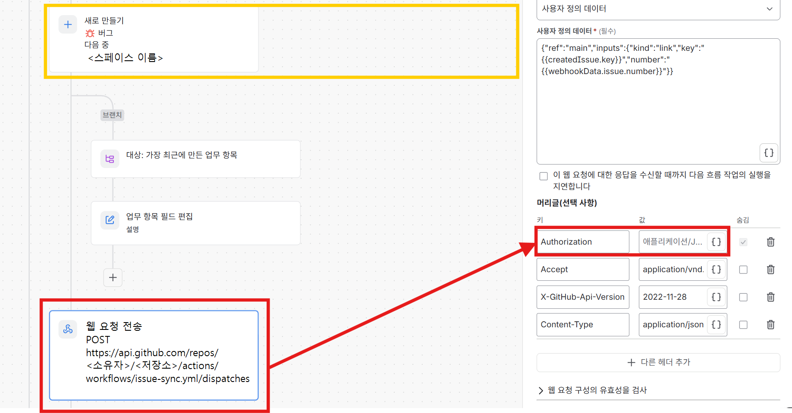

# 02. 설치 순서 — 새 상품에 GitHub ↔ Jira(+Claude 스킬 · Slack) 붙이기

> 전제: [00-결정-체크](00-결정-체크.md) 통과 · [01-바꿀-값](01-바꿀-값.md) 의 0절 빈칸을 채웠다. 흐름이 어떻게 도는지는 [02a-흐름도](02a-흐름도.md). 증상이 나오면 [04-문제해결](04-문제해결.md).
> **순서가 중요한 이유**: `github-to-jira` 규칙의 웹후크 URL·암호는 규칙을 만들어야 나오고, GitHub 워크플로는 `main`(기본 브랜치)에 올라가야 돌며, **워크플로가 `main` 에 없는 채로 규칙을 켜면 웹 요청이 404** 다. 그래서 「규칙 만들기(꺼 둠) → GitHub 에 올리기 → 규칙 켜기」 순서다.
> 🔴 **처음엔 운영 저장소가 아니라 운영과 분리된 환경**(복사본 저장소 + 별도 스페이스)에서 한다 — 운영 저장소에서 시험하면 서비스 버전이 오르고 시험 건이 남는다.
> 🔴 웹후크 주소 · 암호 · PAT · Slack 주소는 **화면에서 복사해 바로 붙여 넣고** 문서·채팅·이슈·커밋에 적지 않는다.

각 단계 끝에 **확인** 줄이 있다. 확인이 안 되면 다음 단계로 가지 않는다.

## 단계 1. Jira — 규칙 5개를 만든다 (켜지 않는다)

규칙은 손으로 처음부터 만들지 않고 **템플릿 5개 + 렌더 스크립트**(`files/jira-rules/`)로 만든다. Node 18 이상이 필요하다.

1. **값 파일**: `files/jira-rules/values.example.json` 을 **저장소 밖**에 복사해 [01 2-0절](01-바꿀-값.md#2-0-값-파일--규칙-json-렌더-스크립트) 의 17개 값으로 채운다. 값을 어떻게 확인하는지는 [01 0-1절](01-바꿀-값.md#0-1-값을-어떻게-확인하나-atlassian-mcp--읽기만).
2. **렌더**: `node files/jira-rules/render-rules.mjs --values <값 파일> --out <출력 폴더>` — 값 형식이 틀리면 이유를 적고 멈춘다. 성공하면 `<SPACE>-github-to-jira.json` 등 5개(모두 **꺼짐**)가 나온다.
3. **가져오기**: `<SPACE>` ▸ 스페이스 설정 ▸ 자동화 ▸ 오른쪽 위 `…` ▸ **규칙 가져오기**(화면에 따라 「흐름 가져오기」) → 5개 파일을 하나씩. 메뉴가 안 보이면 「전역 관리」 화면에서 찾고, 거기에도 없으면 전역 자동화 관리자 권한이 필요하다. 같은 이름의 규칙이 이미 있으면 `Copy of` 가 붙는다.
4. **가져온 직후 확인**: 5개 모두 **꺼짐** · 이름 접두사 · 범위 = `<SPACE>` · 「다른 규칙이 이 규칙을 트리거하도록 허용」 **끔**. 켜져 있으면 바로 끈다.
5. `github-to-jira` 규칙(Jira 에서는 `<PREFIX> Github -> Jira Issue`) 맨 위 트리거 「수신 웹후크」(「웹후크에서 제공된 이슈 없음」)를 열어 **웹후크 URL · 암호**를 얻는다 — 단계 3 의 Secret 값이다. 암호를 다시 만들면 **「규칙 업데이트」까지 눌러야 저장**된다.
6. 🔴 렌더 결과에는 **PAT · Slack 주소 · 웹후크 암호가 없다** — 단계 2 에서 화면에 직접 채운다. 값 파일과 출력 폴더는 저장소에 올리지 않는다.
7. 템플릿을 쓰지 않고 직접 만들거나 규칙을 고칠 때만 아래 함정을 본다: 🔴 키 조회는 **「업무 항목 조회」 동작**이지 「JQL 조건」이 아니다 · 분기를 복사하면 조회 내부 ID 가 같아지니 **새로 추가** · 「상위 항목」 칸은 단순 스마트 값만 · 「추가 옵션」은 줄바꿈까지 비움 · If 블록 분기 안에 If 를 다시 넣을 수 없어 분기 A·B 로 나눈다 · 시험용 「업무 항목 조회」·로그 작업은 게시 전에 지운다.

확인: 5개 모두 **꺼짐**, 범위 = `<SPACE>`, 「허용」 끔.

## 단계 2. 토큰 · Slack 주소 만들기

1. **Jira→GitHub PAT**(저장소 소유 조직 Owner 계정): Settings ▸ Developer settings ▸ Fine-grained tokens ▸ Generate. Resource owner = 조직 · Repository access = **`<REPO>` 하나** · Permissions = **Actions: Read and write 하나만** · 만료 1년 안(일정에 적기). 조직이 승인 대기(Pending)면 조직 Settings ▸ Personal access tokens ▸ Pending requests 에서 승인. 값(`github_pat_…`)은 한 번만 보인다.
2. **Slack**: 앱 디렉터리에서 「Incoming Webhooks」 추가 → 채널 `<SLACK_CHANNEL>` 선택 → 웹후크 URL 복사. 무료 플랜은 워크스페이스에 앱 **10개 한도**(자리 없으면 안 쓰는 앱을 뺀다).
3. **Authorization 7곳**: `github-to-jira`의 웹 요청 3곳 + 나머지 4개 규칙의 웹 요청 1곳씩 — 각 웹 요청의 헤더 `Authorization` 값을 `Bearer <PAT>`(**숨김**)로 채운다. URL · `Accept` · `X-GitHub-Api-Version` · `Content-Type` 은 렌더 결과에 이미 들어 있다 — 7곳의 URL 이 `https://api.github.com/repos/<REPO>/actions/workflows/issue-sync.yml/dispatches` 인지만 훑어본다.
   위치: 규칙 편집 화면에서 **「웹 요청 전송」 동작**(아래 그림 왼쪽 아래 빨간 상자)을 누르면 오른쪽에 설정 창이 열린다. 창 아래쪽 **「머리글(선택 사항)」** 의 `Authorization` 줄(빨간 상자) 값 칸에 `Bearer <PAT>` 를 붙여 넣고 **「숨김」 체크**를 켠다. `Accept` · `X-GitHub-Api-Version` · `Content-Type` 은 건드리지 않는다. 웹 요청이 규칙마다 여러 개(`github-to-jira` 는 3곳)이므로 동작마다 반복한다.

   

4. **Slack 2곳**: 값 파일의 `SLACK_WEBHOOK_URL` 을 비워 두었다면(권장) `github-to-jira` 규칙의 슬랙 동작 2곳(등록 경로 If 블록 · edit 분기 B)에 **가짜 주소**가 들어 있다. 동작이 **「웹후크를 통해 Slack 메시지 보내기」**(「Slack 메시지 보내기」(앱 연결형)가 아님)인지 보고, 웹후크 URL 을 화면에서 붙여 넣는다 · 채널 칸 비움 · 메시지는 렌더 결과 그대로(링크의 사이트 주소는 `<SITE>`). **두 곳 모두 같은 주소**. Slack 알림을 쓰지 않으면 가짜 주소 그대로 두어도 되지만 틀린 상위 에픽 키 알림이 가지 않는다.

확인: 웹 요청 7곳의 `Authorization` 이 채워짐 · 슬랙 2곳 주소가 같음(또는 의도적으로 가짜) · 규칙은 아직 꺼짐.

## 단계 3. GitHub — Secret 넣기

저장소 ▸ Settings ▸ Secrets and variables ▸ Actions ▸ **Repository secrets**(Environment ✕ · Organization ✕):

| Name | 값 |
|---|---|
| `JIRA_<SPACE>_WEBHOOK_URL` | 단계 1-3 의 웹후크 URL(**암호는 붙이지 않는다**) |
| `JIRA_<SPACE>_WEBHOOK_TOKEN` | 단계 1-3 의 암호 |

이름은 대소문자·밑줄까지 **워크플로와 글자 그대로**(01 1-1). 저장한 값은 다시 볼 수 없다.
확인: `gh secret list -R <REPO>` 에 두 이름이 보인다(값은 안 보인다).

## 단계 4. GitHub — 파일을 올린다 (PR → `main` 머지)

파일 복사 · 값 치환 · 대조표 작성은 **스크립트**가 한다 — `node files/tools/install-files.mjs --values <값 파일> --target <상품 저장소> --dry` 로 미리 보고 `--dry` 를 빼 실행한다([01 1-0절](01-바꿀-값.md#1-0-자동으로-넣기-install-filesmjs)). 아래 1의 복사 표는 스크립트가 하는 일의 목록이고, **`ci.yml` 단계 추가(1-5)와 「화면 구현 멈춤」 정리는 직접** 한다.

1. 브랜치를 만들고(`feat/issue-sync` 등 — 이름 규칙은 상품 `CONTRIBUTING.md`) `files/` 를 아래 경로로 복사한 뒤 [01 1절](01-바꿀-값.md#1-github-쪽--파일) 대로 치환한다.

   | `files/` | → 상품 저장소 |
   |---|---|
   | `github/workflows/issue-sync.yml` | `.github/workflows/issue-sync.yml` |
   | `github/github-jira-map.schema.json` | `.github/github-jira-map.schema.json` |
   | (생성) 대조표 | `.github/github-jira-map.yml` — `install-files.mjs` 가 값 파일(팀원 · 업무 유형 · 영역)로 만든다. 예시 파일은 없다 |
   | `github/ISSUE_TEMPLATE/{bug_report,task,feature_request,screen_blocked,config}.yml` | `.github/ISSUE_TEMPLATE/` |
   | `github/scripts/issue-body.mjs` | `.github/scripts/issue-body.mjs` |
   | `claude/skills/report-issue/SKILL.md` | `.claude/skills/report-issue/SKILL.md` |
   | `claude/commands/이슈등록.md` | `.claude/commands/<상품명>/이슈등록.md` |
   | `github/ci-check-map.snippet.yml` | 상품 `ci.yml` 의 steps 에 붙임 |

2. 치환 누락 검사:
   `grep -rnE "<기준 값1>|<기준 값2>|…" .github .claude` (「기준 값」은 [01 0절](01-바꿀-값.md) 표의 「기준 상품의 값」 열)
   **0건은 불가능하다** — 아래만 남아야 하고, 그 밖의 줄은 누락이다.
   - 같은 Jira 사이트를 쓰면 대조표 `jira.cloudId`(`<CLOUD_ID>`) · `jira.site`(`<SITE>`)
   - `SKILL.md` 안의 예시·사례(`EXP-12` · `EXP-6` · `EXP-76` · `<소유자>/<기준 저장소>` 예 등 — 01 4절 「동작 무관」)
   - `issue-sync.yml` 의 payload 키 `bridge`(바꾸면 안 됨 — 01 1-1)
   - 기준 상품의 한글 이름이 `<상품명>` 과 같은 경우
3. 대조표 검사: `npx --yes yaml@2.6.1 --json --single < .github/github-jira-map.yml > map.json && npx --yes ajv-cli@5.0.0 validate --spec=draft7 -s .github/github-jira-map.schema.json -d map.json` → `valid`.
   **맞물림 검사**(워크플로 · 규칙 JSON · 이슈 양식 · 대조표 · 스킬이 같은 값을 가리키는지): `node files/tools/verify-install.mjs --target <상품 저장소> --rules-out <규칙 출력 폴더> --repo <REPO> --deep` — **실패 0** 이어야 한다. 규칙 JSON 은 단계 1 에서 렌더한 출력 폴더다. 오프라인으로 못 보는 것(그 스페이스의 실제 유형 id · 전환 이름 · 필드 id, PAT · Secret 값)은 사람이 확인한다.
4. PR 을 열어 CI 통과 → **`main` 에 머지**. (`issues` · `issue_comment` 이벤트는 기본 브랜치의 파일로만 돈다.)
5. 이슈 유형(Type: Task/Bug/Feature)이 없는 조직이면 워크플로가 「Type 거절 — Type 없이 다시 만든다」 경고를 낸다(동작은 한다).

확인: 맞물림 검사 실패 0 · `git ls-tree origin/main .github/workflows/` 에 `issue-sync.yml` 이 있다 · 저장소 웹훅(방식 A)이 **켜져 있지 않다**(`gh api repos/<REPO>/hooks --jq '.[] | {id, active, events}'` — 켜 있으면 사본이 2건 생긴다).

## 단계 5. Jira — 규칙 5개를 켠다

1. 단계 4 가 끝난 **뒤에** 5개를 켠다.
2. `github-to-jira` 규칙의 「수신 웹후크」 설정이 바뀌지 않았는지(암호 저장됨) 본다.

확인: [03-점검표](03-점검표.md) 의 S1 ~ S3 통과.

## 단계 6. Claude 스킬

1. 단계 4 의 `.claude/skills/report-issue/` · `.claude/commands/…` 가 저장소에 들어가 있으면 **저장소를 새로 연 Claude Code 세션**에서 `/<상품명>:이슈등록` 이 보인다(보이지 않으면 세션을 새로 연다).
2. 사용자 PC 준비(개인마다 한 번): `gh auth login`(저장소 쓰기 권한) · claude.ai ▸ Connectors ▸ **Atlassian 연결**(scopes 에 `write:jira-work`) · Node. 스킬 0단계가 점검하고 못 쓰는 곳은 선택지에서 뺀다.
3. 대조표 `people` 에 **본인 GitHub 아이디 + accountId + roles** 가 있어야 담당·역할 선택지가 나온다.

확인: S8 통과.

## 단계 7. 시험 끝난 뒤 정리

시험 이슈·사본을 닫고(단계 5 이전에 닫으면 신호가 안 간다) 시험용으로 만든 규칙·Secret 의 정리 여부를 정한다. 처음 시험은 복사본 저장소·별도 스페이스에서, 통과 후 같은 절차를 운영 저장소·운영 스페이스에 한 번 더 한다(그때 값이 바뀌는 것은 `<REPO>` · `<SPACE>` · PAT · Secret 이름 · 규칙 이름 접두사 정도다).

## Claude 와 함께 설치하기 — 역할 분담

설치 담당자가 Claude Code 를 열어 이 문서대로 진행시킬 수 있다. Claude 는 **자기가 할 수 있는 것은 직접 하고, 못 하는 것은 「지금 사용자가 할 일」 한 줄로 요청한 뒤 끝났다는 알림을 받을 때까지 기다린다.** 전제: 세션에 `gh` 로그인 · Atlassian 커넥터(읽기·쓰기) · Node 18 이상이 있다.

**전용 스킬**: 이 키트 폴더의 [`SKILL.md`](../SKILL.md)(이름 `issue-sync-install`)가 아래 표대로 진행한다. ai_skills 저장소를 `.claude/skills`(또는 `~/.claude/skills`)에 연결했으면 Claude Code 를 새로 열어 `/issue-sync-install` 로 부른다. 연결하지 않았으면 **키트 폴더째**(`SKILL.md` · `adopt/` · `files/` 함께 — 스킬이 이 파일들을 읽는다) `~/.claude/skills/issue-sync-install/` 로 복사한 뒤 부른다. 스킬은 값을 **도구 결과 · 사용자 답 · 파일에서만** 받고 짐작하지 않으며, 모르면 묻고, 승인이 필요한 일은 하기 전에 묻는다.

| 단계 | Claude 가 직접 한다 | 사용자에게 요청한다 (Claude 가 못 한다) |
|---|---|---|
| **1. Jira 규칙** | Atlassian 도구로 값 수집(프로젝트 id · 유형 id · cloudId · 전환 이름 · 시작 날짜 필드 · 본인 accountId) → 값 파일 작성 → `render-rules.mjs` 실행 → 결과 검사 | **Jira 화면에서 규칙 5개 가져오기** · 5개 꺼짐 확인 · `github-to-jira` 규칙 수신 웹후크 URL·암호 확인. (앱 계정 id 는 기존 규칙 내보내기 파일의 경로를 알려 주면 `actor.value` 한 칸만 읽는다) |
| **2. 토큰 · Slack** | PAT 설정값(저장소 하나 · Actions: Read and write 하나) 안내 · Authorization 7곳 · Slack 2곳 **체크리스트** 제시 | **PAT 발급**(조직 승인 포함) · **Slack 수신 웹후크 앱 추가** · **Jira 화면에서 Authorization 7곳 · Slack 2곳에 붙여 넣기** — 값은 채팅에 적지 않는다 |
| **3. Secret** | Secret 이름 안내 · 등록 확인(`gh secret list` — 이름만 보인다) | **값 등록**: 본인 터미널에서 `gh secret set <이름> -R <REPO>` 실행(값을 채팅에 붙이지 않는다) |
| **4. 파일 PR** | `files/` 복사 · 값 치환 · 대조표 작성(accountId 는 `lookupJiraAccountId`) · 스키마 검증 · 누락 검사 · 브랜치 · 커밋 · push · PR · CI 확인 | push · PR · **머지 승인**(Claude 는 승인 전에 하지 않는다) · 조직 정책상 필요한 리뷰 |
| **5. 규칙 켜기** | 켜기 전 [03 가져온 직후 점검](03-점검표.md) 항목을 하나씩 확인하자고 안내 | **Jira 화면에서 규칙 5개 켜기** |
| **6. 스킬** | 스킬 · 별칭 파일은 단계 4 에 포함됨 · 세션에서 `/<상품명>:이슈등록` 이 보이는지 확인 | 각자 PC: `gh auth login` · claude.ai ▸ Connectors ▸ Atlassian 연결 · Claude Code 를 저장소에서 새로 열기 |
| **7. 점검 · 정리** | [03 S0~S9](03-점검표.md) 를 `gh` 와 Atlassian 도구로 직접 실행·판정 · 시험 이슈 닫기 | **쓰기 승인**(운영 스페이스에 시험 이슈를 만들어도 되는지) · Slack 메시지 도착 확인 · **Jira 규칙 감사 로그**를 붙여 넣기(Claude 는 규칙 감사 로그를 읽지 못한다) · 시험 이슈 **삭제**(Claude 도구에는 삭제가 없다) |

### Claude 가 못 하는 것 (이유)
- **Jira 자동화 규칙의 가져오기 · 켜기 · 편집**: Atlassian 도구에 자동화 규칙을 다루는 기능이 없다(이슈 · 댓글 · 전환만 된다).
- **비밀값 입력**: PAT · Slack 주소 · 웹후크 암호는 채팅과 파일에 남지 않게 사용자가 화면 · 터미널에서 직접 넣는다.
- **이슈 · 에픽 삭제, 규칙 감사 로그 조회**: 해당 도구가 없다.
- 저장소 원격 주소 변경 같은 **되돌리기 어려운 작업**은 권한 검사에서 막힐 수 있다 — 사용자가 명시적으로 허용해야 한다.

### 요청할 때 Claude 가 지키는 형식
1. 사용자가 할 일을 **한 번에 하나**, 어디(메뉴 경로)서 무엇을 하는지로 적는다.
2. 값이 필요하면 **어디서 복사해 어디에 넣는지**만 적고, 값 자체는 요구하지 않는다.
3. 끝났다는 답이 오면 Claude 가 **직접 확인할 수 있는 것**(예: `gh secret list` · 규칙 목록 캡처 · Jira 이슈 조회)으로 확인한 뒤 다음 단계로 간다. 확인할 수 없는 것은 확인할 수 없다고 말한다.
4. 승인이 필요한 일(push · 머지 · 운영 스페이스 쓰기 · 원격 주소 변경)은 **하기 전에** 묻는다.

## 되돌리기

워크플로·규칙을 끄면 동기화만 멈춘다. 이미 만든 사본은 남는다(삭제하지 않는다).
