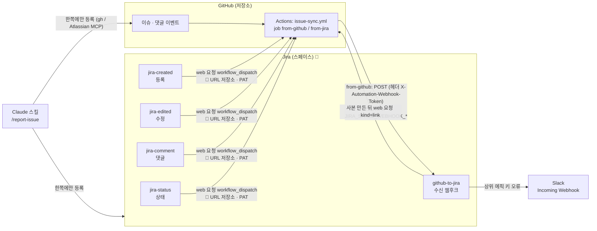
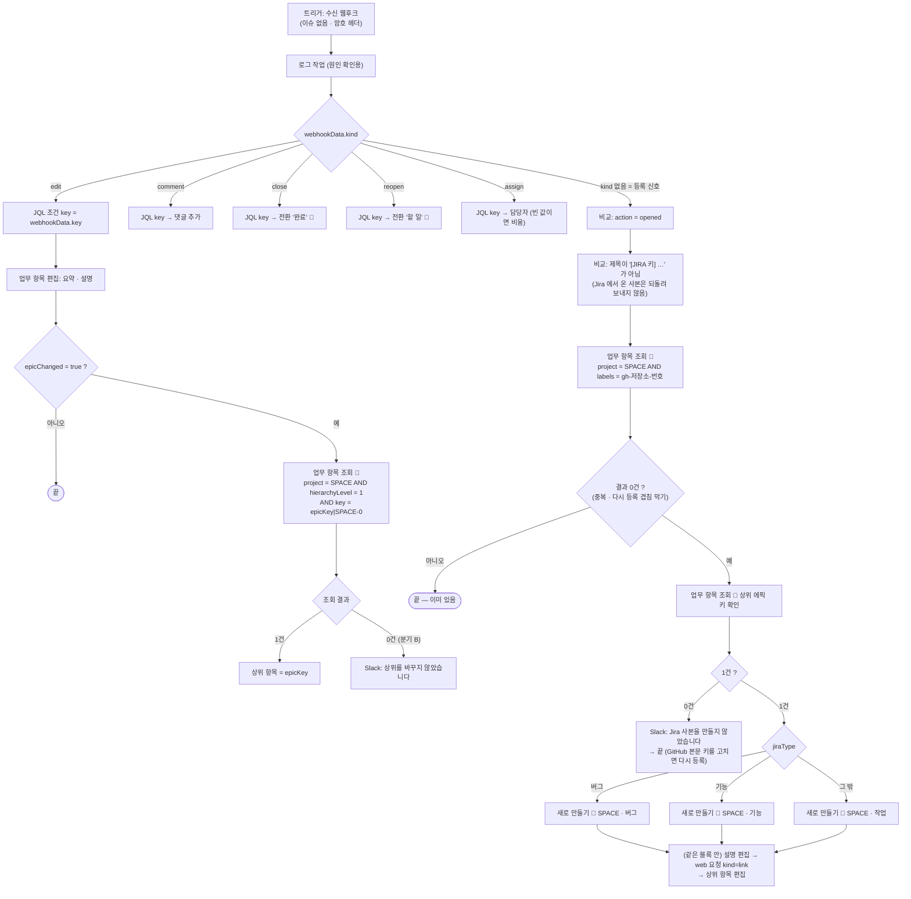
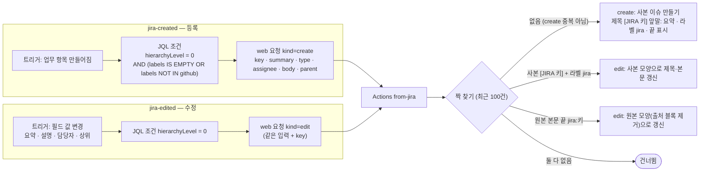
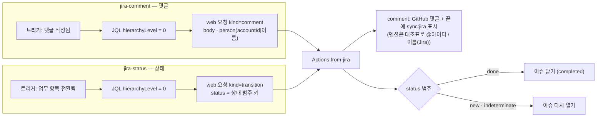
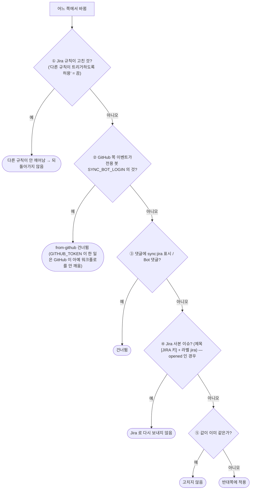
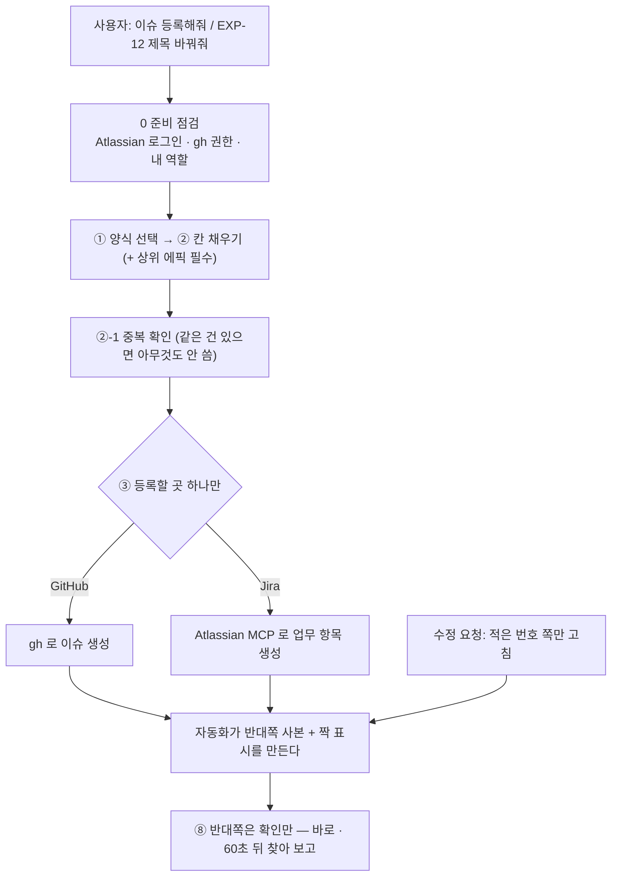

# 02a. 흐름도 — 워크플로 · Jira 자동화 규칙 5개 · 스킬 · Slack

> 근거: `files/github/workflows/issue-sync.yml` · `files/jira-rules/templates/`. Jira 화면 순서(트리거 → 조건 → 액션)로 그려 설치자가 규칙 편집 화면과 대조할 수 있다. 그림에 **🔧** 는 상품마다 바꿀 값이 있는 칸이다([01-바꿀-값](01-바꿀-값.md)).
> 보는 법: Mermaid 를 지원하는 뷰어(GitHub · VS Code 미리보기)에서 그림으로 보인다.

## 1. 전체 지도

핵심: **방향은 job 이름으로 안다** — `from-github` 가 실패하면 GitHub→Jira, `from-jira` 가 실패하면 Jira→GitHub. GitHub 쪽은 기본 토큰(`GITHUB_TOKEN`)이 이슈를 쓰고, Jira 쪽은 규칙 실행 주체가 쓴다.

## 2. `github-to-jira` 규칙 — 가장 복잡한 규칙

기억할 점
- 블록 밖 단계는 블록 안에서 만든 항목을 못 본다 — 그래서 「만들기 → 편집 → 웹 요청 → 상위 편집」이 **각 유형 블록 안**에 있다.
- 「업무 항목 조회」는 **동작**(다른 항목 검색), 「JQL 조건」은 **현재 항목 검사** — 혼동하면 분기가 안 탄다.
- 조회 결과 이름은 모두 `lookupIssues` 다 — 바로 앞 조회의 값을 본다(중복 확인 → 키 조회 순서라 키 조회 결과로 덮임).
- 설명을 만들 때 비우고 편집 단계에서 채우는 이유: Slack 「created」 알림이 만드는 순간의 설명을 싣기 때문.

## 3. `jira-created` · `jira-edited` 규칙 — Jira 에서 만들고 고친 것이 GitHub 으로

핵심: **에픽(레벨 1)과 하위 작업(-1)은 GitHub 으로 넘기지 않는다** — `jira-created` 규칙의 `hierarchyLevel = 0` 조건. 이 조건이 없으면 에픽이 GitHub 이슈가 된다.

## 4. `jira-comment` · `jira-status` 규칙 — 댓글 · 상태

핵심: 상태는 **이름이 아니라 범주**로 판단한다 — 상품 스페이스에 「보류」 같은 상태가 있으면 범주를 `indeterminate` 로 둔다(완료 범주로 두면 GitHub 이 닫힌다).

## 5. 반복(루프) 방지 — 판단 지점 5곳

## 6. 스킬 `/report-issue` — 한쪽에만 쓴다

- **창구 차이**: 스킬은 양식·대조표대로 조립하고 **중복 확인**과 **반대쪽 사본 확인 보고**가 있다. Jira MCP 를 직접 쓰면 중복 확인이 없어 기존 항목을 찾아 고치기도 하고, 설명 전체를 다시 써서 글자가 깨질 수 있다. GitHub 쪽 등록은 MCP 로 불가.
- 양쪽에 다 쓰면 같은 변경이 두 번 오가고 순서가 엇갈려 값이 뒤집힌다 — **한쪽만**.

## 다이어그램 ↔ 소스 대조 (이 문서를 고칠 때)

| 그림 | 소스 |
|---|---|
| `github-to-jira` 규칙 | `files/jira-rules/templates/github-to-jira.template.json` (슬랙 문구 포함) |
| `jira-created` · `jira-edited` 규칙 | `jira-created` · `jira-edited` 템플릿 · `issue-sync.yml` 의 from-jira 단계 |
| `jira-comment` · `jira-status` 규칙 | `jira-comment` · `jira-status` 템플릿 · `issue-sync.yml` 머리 주석 20-25행 |
| 스킬 그림 | `files/claude/skills/report-issue/SKILL.md` 4절 표 · 2절 규칙 1 |
